# MovieShelf

MovieShelf is an Android app for searching movies on [The Movie Database (TMDB)](https://www.themoviedb.org/). You can search for a title, browse the results, open a movie to see its details, and come back to everything you have already searched when you have no connection.

## Contents

1. [Build and run](#build-and-run)
2. [Screenshots](#screenshots)
3. [Features](#features)
4. [Architecture](#architecture)
5. [Libraries](#libraries)
6. [Offline first, and then local search](#offline-first-and-then-local-search)
7. [Decisions worth explaining](#decisions-worth-explaining)
8. [Tests](#tests)
9. [Known limitations](#known-limitations)
10. [Future developments](#future-developments)

## Build and run

### What you need

- A recent version of Android Studio that supports Android Gradle Plugin 9.3.
- Android SDK Platform 37. Android Studio offers to install it the first time you sync if it is missing.
- An emulator or a device running Android 7.0 (API 24) or newer.
- A free TMDB account to get an API key.

You don't need to install a specific JDK. The project declares a Gradle daemon toolchain (JDK 25), and Gradle downloads it automatically the first time if your machine doesn't have it.

### 1. Get a TMDB API key

Create an account at [themoviedb.org](https://www.themoviedb.org/signup), then go to **Settings > API** and request a developer key. When it's ready you will see two values on that page. Copy the one called **API Key**. The app sends it as the `api_key` query parameter, so the longer "API Read Access Token" will not work.

### 2. Add the key to `local.properties`

Open (or create) `local.properties` in the root folder of the project and add this line:

```properties
TMDB_API_KEY=paste_your_key_here
```

Android Studio usually creates this file already with an `sdk.dir` line in it. Leave that line as it is and just add yours below. The file is ignored by Git, so your key never ends up in a commit.

That's the only setup step. I tested it on a clean copy of the repository: the build reads the key from that file, and if you add it after a first build, the next build picks it up without any extra step.

If you prefer, you can also pass the key as an environment variable called `TMDB_API_KEY`, which is handy on CI.

### 3. Run the app

From Android Studio, open the project, wait for the Gradle sync to finish, choose the `app` run configuration and press Run.

From the command line, with a device or emulator connected:

```bash
./gradlew :app:installDebug
```

If the key is missing or wrong the app still builds and opens, but every search shows a message saying that TMDB didn't accept the API key.

### Running the tests

```bash
# JVM unit tests (no device, network or API key needed)
./gradlew :app:testDebugUnitTest

# Instrumented tests (Room DAOs, database migrations and a few UI tests), needs a device or emulator
./gradlew :app:connectedDebugAndroidTest
```

> A note on the key: it gets compiled into `BuildConfig`, so keeping it out of Git only protects it from being published by accident. Anyone with the APK could still extract it. A real product would send these requests through its own backend.

## Screenshots

All of them were taken on the Android emulator (Medium Phone profile, API 36).

<table>
  <tr>
    <td align="center">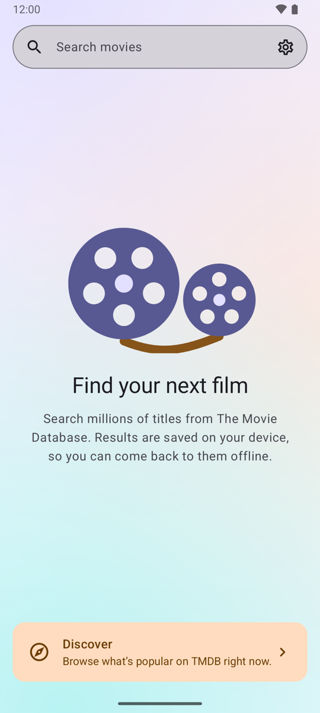<br>Home</td>
    <td align="center">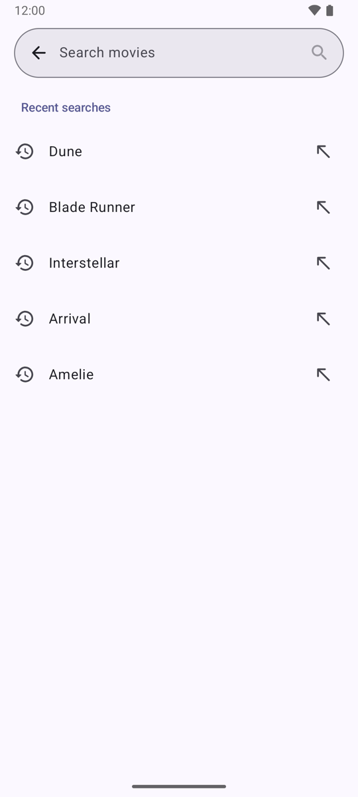<br>Search with recent searches</td>
    <td align="center">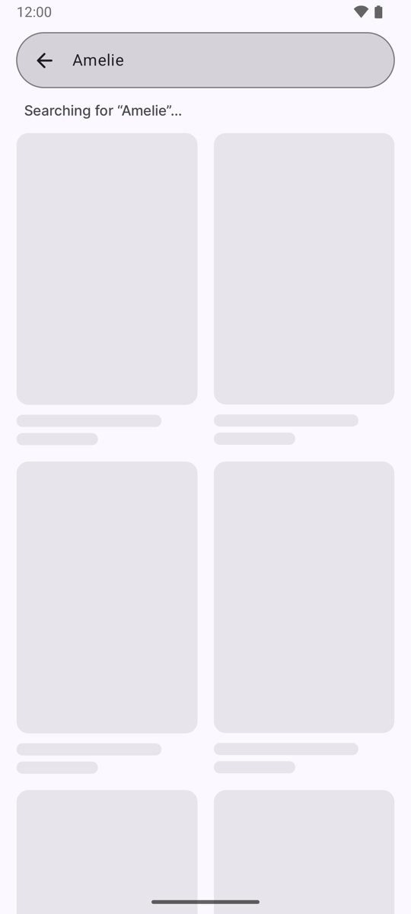<br>Loading</td>
  </tr>
  <tr>
    <td align="center">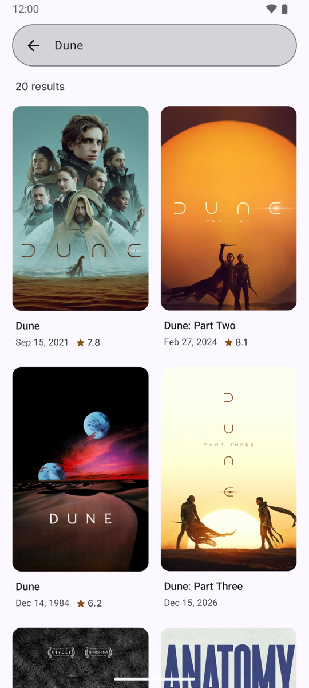<br>Results</td>
    <td align="center">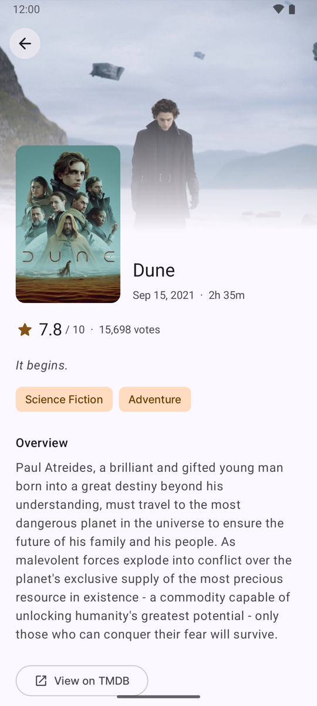<br>Movie detail</td>
    <td align="center">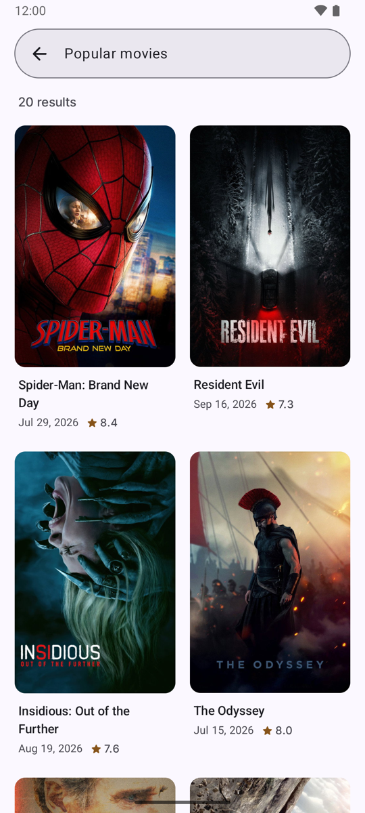<br>Discover</td>
  </tr>
  <tr>
    <td align="center">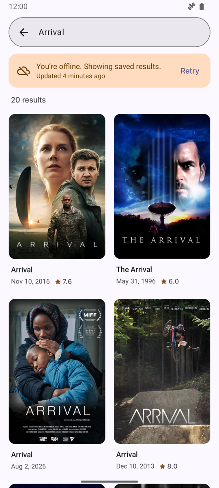<br>Offline, saved results</td>
    <td align="center">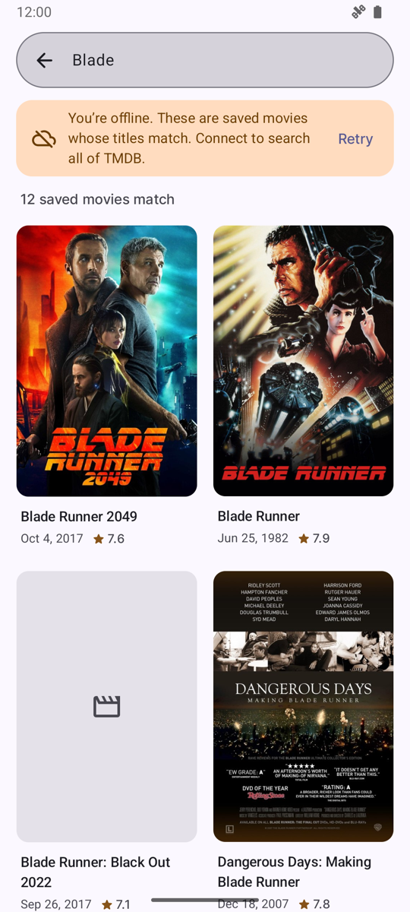<br>Offline, new query with local matches</td>
    <td align="center">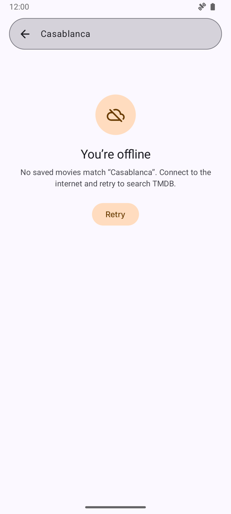<br>Offline, nothing saved</td>
  </tr>
  <tr>
    <td align="center">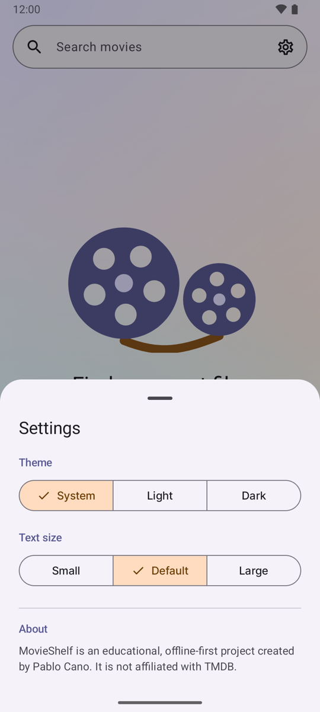<br>Settings</td>
    <td align="center">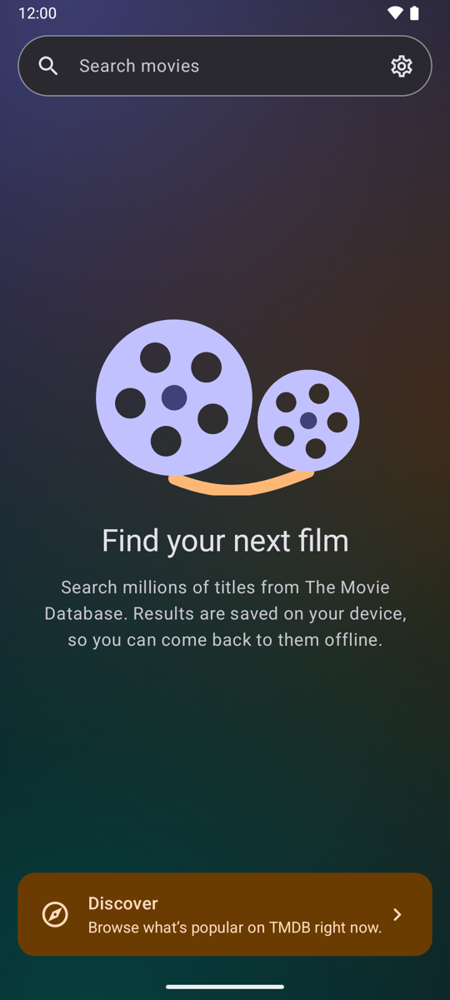<br>Home, dark theme</td>
    <td align="center">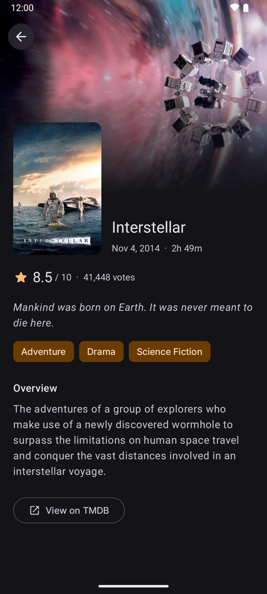<br>Movie detail, dark theme</td>
  </tr>
</table>

## Features

**Core features**

- Search movies through the TMDB API.
- Show results with title, release date and poster.
- Show a detail page with title, overview, release date, rating and poster.
- Loading, empty and error states.
- Search results cached in a local database and available offline.
- Written in Kotlin with MVVM, a repository layer and unit tests for ViewModels and repositories.

**More features**

- A full-screen search page that opens from the search bar on Home, similar to Google Maps. It lists your recent searches, and you can long-press one to remove it.
- A request is only sent when you submit the search. Typing doesn't trigger anything.
- The poster moves from the results grid into the detail page with a shared-element transition.
- A "Load more" button to fetch further pages of results. Every page you load is saved too.
- Discover, which shows what's popular on TMDB right now.
- When you're offline and search for something new, the app looks through the movies it has already saved and shows the ones whose titles match.
- The app follows the device's connection. It tells you when you're offline and when you're back online, and it doesn't send requests it knows will fail.
- A settings sheet to pick the theme (system, light or dark) and the text size. These are stored with DataStore.
- A "View on TMDB" button on the detail page.
- Pull to refresh on the results.

## Architecture

The app follows Clean Architecture with MVVM, inside a single Gradle module. I didn't split it into several modules because the project is small and the extra build setup wouldn't pay off yet. Instead, the layers are separate packages and the dependencies only go one way:

```
presentation  ->  domain  <-  data
```

The domain layer is plain Kotlin. It knows nothing about Android, Room, Ktor or Koin, so it's easy to test and to replace the pieces around it.

```
com.canolabs.movieshelf
├── app/            Application class and the Navigation 3 setup
├── di/             Koin modules (network, data, domain, app)
├── domain/
│   ├── model/        Plain models such as Movie, SearchQuery, CachedSearch, RefreshResult
│   ├── repository/   Repository contracts (search, movies, settings, connectivity)
│   └── usecase/      One use case per action, each with a single invoke()
├── data/
│   ├── remote/       Ktor service, DTOs and the remote data source
│   ├── local/        Room entities, DAOs, database, migrations and the local data source
│   ├── connectivity/ Network status from ConnectivityManager
│   ├── mapper/       DTO to entity and entity to domain mappers
│   └── repository/   Repository implementations that coordinate local and remote
├── presentation/   Compose screens and their ViewModels (home, searchentry, results, detail, settings)
└── ui/theme/       Material 3 theme, colours and typography
```

You can browse the code under [`app/src/main/java/com/canolabs/movieshelf`](app/src/main/java/com/canolabs/movieshelf).

A few rules I kept throughout:

- DTOs stay in the remote package and Room entities stay in the local package. The rest of the app only sees domain models.
- ViewModels talk to use cases, never to a DAO or to the HTTP client.
- Each use case has an interface and an implementation, so tests can swap them easily.
- The repository decides when to call the network and when to read Room. The local and remote data sources don't know about each other.

### Screens and state

There is one ViewModel per screen, and each one exposes its state as a `StateFlow`.

Most screens are plain MVVM. The Results screen is the exception: it uses a small MVI contract with a `UiState`, `UiIntent` and `UiAction`, plus a pure reducer function. I made that choice because this screen has to merge several things at once: the cached results from Room, the matching saved movies, the connection status, the state of the refresh and the state of "Load more". Putting all of that in one reducer made the tricky combinations easy to read and easy to unit test, for example "offline, nothing cached, but some saved movies match the title". I didn't build a generic MVI framework. The contract lives only on that screen.

### Navigation and motion

Navigation uses Jetpack Navigation 3. The back stack is a list of serializable keys (Home, Search entry, Results and Movie detail), so it survives process death. Each Results entry gets its own ViewModel, so a screen can never show the results of a different query.

The whole navigation host sits inside one `SharedTransitionLayout`. That allows two transitions: the search bar on Home grows into the full-screen search field, and the poster flies from the results grid into the detail page. The shared-element keys come from the movie ID.

## Libraries

| Area | Library |
|---|---|
| UI | Jetpack Compose with Material 3 |
| Navigation | Navigation 3 |
| Networking | Ktor Client (OkHttp engine) with kotlinx.serialization |
| Local database | Room, with KSP |
| Preferences | DataStore Preferences |
| Dependency injection | Koin |
| Images | Coil 3, using its Ktor network fetcher |
| Animations | Lottie for the Home illustration, Compose shared transitions for screen changes |
| Async | Kotlin Coroutines and Flow |
| Fonts | Downloadable Google Fonts (Space Grotesk and Inter) |
| Tests | JUnit 4, kotlinx-coroutines-test, Ktor MockEngine, Room testing, Compose UI test |

All versions are stable releases and live in [`gradle/libs.versions.toml`](gradle/libs.versions.toml).

## Offline first, and then local search

I built the offline support in two steps.

### Step 1: Room as the single source of truth

The UI never displays a network response directly. A search goes like this:

```
User submits -> Ktor request -> DTOs -> entities -> Room transaction
                                                         |
Compose <- ViewModel StateFlow <- use case <- repository <- Room Flow
```

The network call is a one-shot suspend function. When it succeeds, the results are written to Room in a single transaction, and the screen only updates because Room emits the new data. That gives a few useful properties:

- A search you have done before opens instantly from the database, with or without a connection.
- If a refresh fails, the cached results stay on screen with a notice and a Retry button. Nothing gets deleted.
- A successful response with zero results is a real answer, so it replaces the old results for that query.
- If nothing is cached and the request fails, the app shows an error. It doesn't pretend the search returned nothing.
- Each query is stored under a normalized key (trimmed, extra spaces removed, lower case), so "Dune" and " dune " share the same cache, while results of one query can never appear under another one.

The database has three tables: `movies`, with one row per TMDB movie, `search_queries`, with one row per query, and `search_results`, a junction table that links them and keeps each result's position, so the order from TMDB is preserved. Refreshing a search only updates the summary columns of a movie, so the runtime, genres and tagline fetched by the detail page are not lost.

### Step 2: searching what's already on the device

After step 1, a new query typed while offline could only show an error, even if the database already held movies with that title. So I changed two things:

- Movies are never deleted anymore, even when no query points to them. The `movies` table slowly becomes a small local catalogue of everything you have seen.
- When the device is offline and a query has no cached results, the app runs a title search (`LIKE`) against that catalogue and shows the matches under a clear notice: "These are saved movies whose titles match". Those matches are never written into the query's cache, because they are not real TMDB results.

Around that, the app also became aware of connectivity. It reads the network state from `ConnectivityManager` (ignoring VPNs, which can report a connection that isn't really there). When the device is clearly offline, it doesn't send the request at all and goes straight to saved data. When the connection comes back, it shows a "You're back online" notice with a Retry button, but it never fires a request on its own. Requests only happen when the user asks for them.

## Decisions worth explaining

- **Search on submit, no debounce.** Sending a request on every keystroke would waste calls and fill the cache with half-typed queries. Recent searches cover the "quick access" part instead.
- **Ktor instead of Retrofit.** Ktor is coroutine-first and Kotlin-first, and Coil can reuse it for images through its Ktor fetcher.
- **Koin instead of Hilt.** It needs no annotation processing and keeps the setup short for an app this size. All dependencies are passed through constructors, so tests just use fakes.
- **Stale requests can't overwrite newer ones.** Every submitted query gets its own Results destination and ViewModel. Inside a screen, a new refresh cancels the previous one, and a generation counter discards a result that was already on its way. A late response for an old query only updates that query's own cache.
- **No loading from `init` or `LaunchedEffect`.** Results and Detail don't start their first request when the ViewModel is created, and the UI doesn't trigger it with a `LaunchedEffect` either. The request is attached to the state itself with `onStart { ... }` before `stateIn(viewModelScope, SharingStarted.WhileSubscribed(5_000), ...)`, so it starts when the screen first observes the state. That keeps side effects out of the constructor, makes it easy to decide in tests when loading begins, and doesn't depend on recomposition. Because `WhileSubscribed` restarts the flow after five seconds without observers, a flag in `SavedStateHandle` makes sure the request runs only once, even after configuration changes or process recreation.
- **Pagination with a button, not infinite scroll.** "Load more" makes it obvious when a new request happens, which matters in an app where the connection can drop at any time.
- **Room schema exported and migrated.** The database is on version 3, and the migrations from versions 1 and 2 are covered by instrumented tests.
- **English only, on purpose.** Dates and numbers are formatted in English so the UI doesn't mix languages on a device set to another locale.

## Tests

There are 164 JVM unit tests and 27 instrumented tests, and none of them needs a real network or an API key.

The unit tests focus on the repositories and ViewModels:

- **Repositories:** responses are saved before success is reported, cached results survive a failed refresh, no cache plus a failure gives an error, an empty success replaces old results, queries stay isolated, order is kept, pagination, recent searches and local title matches.
- **ViewModels:** initial state, submitting a query, loading, content, empty and error states, offline behaviour with and without cached content, "back online", retry, load more, and making sure an older request can't replace the state of a newer one.
- **Others:** the Results reducer, the remote data source (HTTP errors, bad JSON and I/O errors using Ktor's MockEngine), connectivity, formatters and settings.

The repository tests use an in-memory fake of the local data source that follows the same rules as the Room implementation. The real SQL is covered separately by instrumented tests for the DAOs, title search, pagination and database migrations.

## Known limitations

- Images you haven't seen yet can't appear offline. Posters come from Coil's disk cache, which only holds images that were already displayed. In the offline screenshot above you can see a placeholder for one of them.
- The offline title search uses SQL `LIKE`, so it ignores case but not accents. Searching "Amelie" won't find "Amélie" offline.
- Fonts are downloaded through Google Play services. On a device without Play services the app falls back to the system font.
- Material 3 Expressive components aren't public in the stable Material 3 release used here (1.4.0), so I stayed with the stable components and added my own spring-based motion.
- The library versions are the newest ones that work with Kotlin 2.2.10, the version that comes with the Android Gradle Plugin used here. Some newer releases of Ktor, Koin and Coil need Kotlin 2.3 or 2.4, and I preferred not to upgrade the whole toolchain for that alone.

## Future developments

Things I would like to add if I kept working on it:

- **Favourites and watchlist.** Save movies to your own lists, stored in Room so they work offline, with a filter to see only what you haven't watched yet.
- **Trailers.** TMDB returns the video keys for each movie, so the detail page could play the YouTube trailer.
- **Cast and crew.** Show the main cast on the detail page and let you open an actor's page to see their other movies.
- **Similar movies and recommendations** at the bottom of the detail page.
- **Filters and sorting** by year, genre or rating, using TMDB's discover endpoint.
- **Smarter offline search.** Ignore accents and use SQLite full-text search (FTS) to also search the overview, not just the title.
- **Download posters for offline use** in the background with WorkManager, for the searches you've saved.
- **Tablet and foldable layouts** with a list and detail side by side, using Navigation 3 scenes.
- **More languages**, using TMDB's `language` parameter and Android's per-app language setting.
- **Material 3 Expressive** components once they reach a stable release.
- **A small backend** that holds the API key and forwards requests, so the key doesn't ship inside the app.
- **CI with GitHub Actions** to run lint and the tests on every push, plus screenshot tests for the main screens.

---

This product uses the TMDB API but is not endorsed or certified by TMDB.
